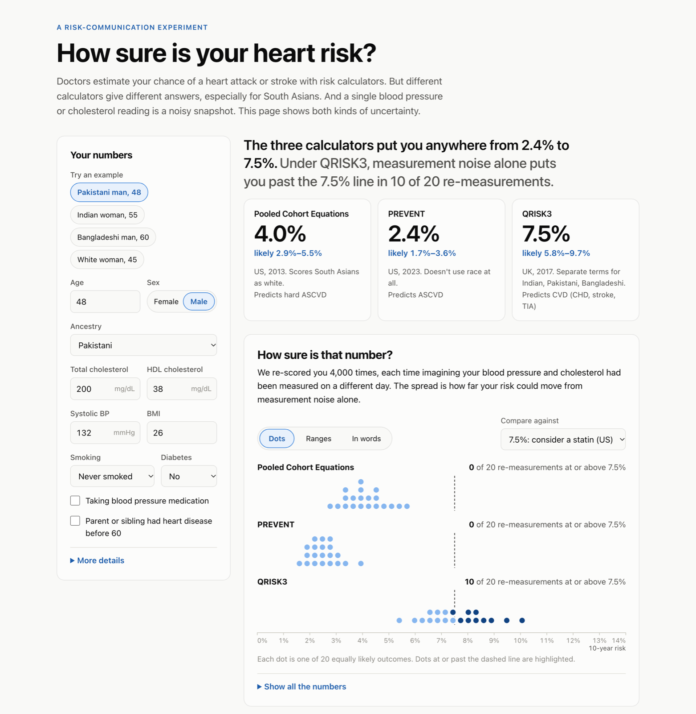
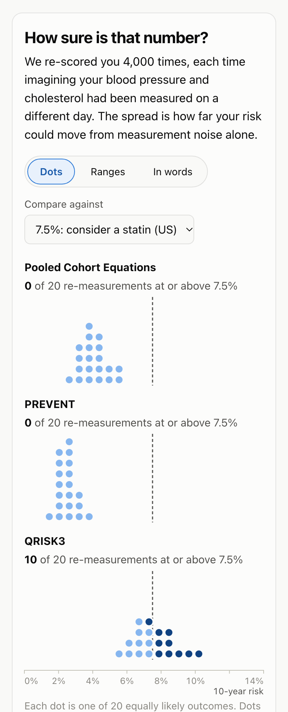

# South Asian Heart Risk

[](https://github.com/Anika-Lakhani/south-asian-heart-risk/actions/workflows/ci.yml)

**Your 10-year heart risk depends on which calculator you ask, and on which day your blood pressure was measured.** This project makes both kinds of uncertainty visible, with a focus on South Asians, the group standard US calculators handle worst.

**[Try it live →](https://anika-lakhani.github.io/south-asian-heart-risk/)**

<a href="https://anika-lakhani.github.io/south-asian-heart-risk/">
  <picture>
    <source media="(prefers-color-scheme: dark)" srcset="docs/screenshots/desktop-dark.png">
    
  </picture>
</a>

## The problem

People of South Asian descent develop heart disease earlier and at higher rates than most other groups. But the risk calculators clinicians use disagree sharply about them:

| Model | Who it was built on | How it treats South Asians |
|---|---|---|
| **Pooled Cohort Equations** (ACC/AHA 2013): the standard US calculator | US cohorts, white and African American adults | Scored as white |
| **PREVENT** (AHA 2023) | 6M+ US adults | Race is not an input |
| **QRISK3** (UK, 2017) | 7.9M UK primary-care patients | Separate terms for Indian, Pakistani, and Bangladeshi |

The 2018 ACC/AHA cholesterol guideline acknowledges the gap by calling South Asian ancestry a "risk-enhancing factor", but leaves the adjustment to the clinician.

Here's one 48-year-old man (total cholesterol 200, HDL 38, SBP 132, BMI 26, non-smoker, no diabetes), scored by this package:

| Ancestry | PCE | PREVENT | QRISK3 | Chance QRISK3 is really ≥ 7.5%* |
|---|---|---|---|---|
| White | 4.0% | 2.4% | 4.7% | 0% |
| Indian | 4.0% | 2.4% | 6.2% | 11% |
| Pakistani | 4.0% | 2.4% | 7.5% | 49% |
| Bangladeshi | 4.0% | 2.4% | 7.9% | 62% |

\* Share of simulated re-measurements of his blood pressure and cholesterol that put QRISK3 at or above 7.5%, the US threshold for discussing a statin.

The same man gets a 2.4%–7.9% spread depending on the model. A single clinic reading also can't say which side of a treatment threshold he's on. The models also predict slightly different outcomes (see [caveats](#caveats)), but the gap is too large to explain away.

## Where this came from

This grew out of a Harvard CS 2790r (HCI) project with Sanjna Kedia and Krisha Patel on **communicating risk and uncertainty to patients**. The core finding from that literature: static error bars get misread, while interactive displays and frequency framings such as quantile dotplots ([Kay et al. 2016](https://doi.org/10.1145/2858036.2858558), [Fernandes et al. 2018](https://doi.org/10.1145/3173574.3173718)) help people understand uncertainty and keep their trust ([Yang et al. 2024](https://doi.org/10.1145/3613904.3642371)). This rebuild applies that to a real clinical gap, with risk models that are published and validated rather than invented.

One principle carries over from the original design: **probabilities are shown as computed.** No "subjective correction" is applied to make risks feel more intuitive, because patients deserve their actual numbers.

## The app

The [app](https://anika-lakhani.github.io/south-asian-heart-risk/) scores you with all three models, then shows how far each number could move, in your choice of three formats from the original study design:

- **Dots**: a quantile dotplot. Each of 20 dots is one equally likely re-measurement, and the dots past the treatment threshold are highlighted, so "10 of 20" is something you can count. Dots keep their identity as inputs change, so you can watch the distribution shift as you edit, and on first load they drop in one at a time, a nod to the dice paper's Plinko display.
- **Ranges**: 90% and middle-50% bands around each estimate.
- **In words**: a plain-language summary for each model.



It also shows the same person scored as white (only QRISK3 changes), and what-if sliders that update every model live as you drag. The headline sentence is generated from your results, so it says what matters for *you* ("the calculators disagree about which side of the line you're on"). Everything follows the system light/dark theme, using blue palettes that pass colorblind-safety and contrast checks in both modes; every chart has an accessible text description and a table twin, and animation respects reduced-motion settings.

Add `?theme=dark` or `?theme=light` to the URL to override the system setting.

```bash
cd web
npm install
npm run dev    # http://localhost:5173/south-asian-heart-risk/
```

<br clear="right">

## How it's built

```
src/heartrisk/   Python reference implementation (NumPy, vectorized)
tests/           Python tests against published reference values
web/             The app: React + TypeScript + hand-built SVG charts, no chart library
  src/models/    TypeScript port of the models, tested for parity with Python
scripts/         Generators that keep Python and TypeScript in sync
```

The models exist twice, once in Python and once in TypeScript, so the app can run entirely in the browser with no server. To keep the two from drifting, Python is the source of truth: [`scripts/export_web_models.py`](scripts/export_web_models.py) generates the QRISK3 coefficient tables for TypeScript, plus a fixture of 300 random profiles scored in Python. The TypeScript tests must reproduce every one to 12 decimal places, and a Python test fails if the generated files go stale.

Every push to `main` runs both test suites, then builds and deploys the app to GitHub Pages.

## The Python package

```bash
pip install -e ".[dev]"
```

```python
from heartrisk import Profile, score, simulate

me = Profile(
    age=48,
    sex="male",
    ethnicity="pakistani",
    total_cholesterol=200,
    hdl_cholesterol=38,
    systolic_bp=132,
    bmi=26,
)

for key, result in score(me).items():
    print(f"{result.model.name}: {result.risk:.1%} ({result.model.outcome})")

sim = simulate(me)  # 4,000 plausible re-measurements
sim.interval("qrisk3", level=0.9)  # (0.057, 0.097)
sim.prob_above("qrisk3", 0.075)  # 0.49
sim.quantile_dots("qrisk3", n_dots=20)  # data for a quantile dotplot

simulate(me, bp_readings=3)  # averaging readings narrows the spread
```

All model functions are vectorized with NumPy, so scoring thousands of samples is a single call.

## How it's validated

Every model is tested against reference values published by its authors:

- **QRISK3**: all 48 reference profiles scored by ClinRisk's original C implementation match to 0.1%. The coefficient tables are generated from ClinRisk's source by [`scripts/gen_qrisk3_tables.py`](scripts/gen_qrisk3_tables.py), not typed by hand.
- **PREVENT**: matches Table S25 of the paper's supplement (total CVD, ASCVD, heart failure).
- **PCE**: matches the worked example in the 2013 guideline for all four sex/race groups.
- **TypeScript port**: passes the same reference checks independently, and matches the Python implementation on 300 random profiles.

Measurement variability defaults are approximate literature values (SBP within-person SD ≈ 12 mmHg; total and HDL cholesterol biological CV ≈ 6% and 7%). They're configurable via `MeasurementVariability`.

```bash
pytest                    # Python: 71 tests
cd web && npm test        # TypeScript: 358 tests
```

## Roadmap

1. ✅ **Risk models + uncertainty engine.** PCE, PREVENT, and QRISK3 as a tested, vectorized package, plus Monte Carlo propagation of measurement noise.
2. ✅ **Interactive web app.** Three uncertainty displays (animated quantile dotplots, interval bands, plain-language summaries), an ancestry comparison, and live what-if sliders, deployed to GitHub Pages.
3. **ML model.** Reproducible training on CDC BRFSS survey data, with held-out evaluation, calibration, per-person explanations, and a model card. The model card will be upfront that US survey data doesn't separate South Asians from other Asians.
4. **Write-up.** A short case study on the design decisions, with screenshots.

## Caveats

- **The outcomes differ.** PCE predicts hard ASCVD (heart attack, coronary death, stroke). PREVENT predicts ASCVD. QRISK3 predicts CVD including TIA, a slightly broader outcome. Some of the gap comes from that.
- **The populations differ.** QRISK3 is calibrated to UK patients. Its South Asian terms describe British South Asians, who may differ from South Asians in the US.
- **QRISK3 inputs the US models don't use** (Townsend deprivation score, SBP variability, and several conditions) default to neutral values unless provided.

## Sources

- Goff DC Jr, et al. 2013 ACC/AHA Guideline on the Assessment of Cardiovascular Risk. *Circulation* 2014;129:S49–S73.
- Khan SS, et al. Development and Validation of the American Heart Association's PREVENT Equations. *Circulation* 2024;149:430–449.
- Hippisley-Cox J, Coupland C, Brindle P. Development and validation of QRISK3 risk prediction algorithms. *BMJ* 2017;357:j2099.
- Grundy SM, et al. 2018 AHA/ACC Guideline on the Management of Blood Cholesterol. *Circulation* 2019;139:e1082–e1143.
- Muntner P, et al. Reproducibility of visit-to-visit variability of blood pressure measured as part of routine clinical care. *J Hypertens* 2011;29:2332–2338.

## License

MIT, except the files that implement ClinRisk's QRISK3-2017 algorithm, which are LGPL-3.0-or-later like the original: [`src/heartrisk/models/qrisk3.py`](src/heartrisk/models/qrisk3.py), [`web/src/models/qrisk3.ts`](web/src/models/qrisk3.ts), and [`web/src/models/qrisk3Coefficients.ts`](web/src/models/qrisk3Coefficients.ts). See [LICENSE](LICENSE) and [LICENSES/](LICENSES/).

## Disclaimer

This is an educational project, not a medical device, and it does not give medical advice. Talk to a clinician about your heart health.

*QRISK3 disclaimer, as ClinRisk requires:* QRISK3-2017 was developed by ClinRisk Ltd., who released the code under the GNU Lesser General Public License to enable others to implement the algorithm faithfully. ClinRisk Ltd. stress that it is the responsibility of the end user to check that the source they receive produces the same results as the original code found at [qrisk.org](https://qrisk.org). Inaccurate implementations of risk scores can lead to wrong patients being given the wrong treatment.
