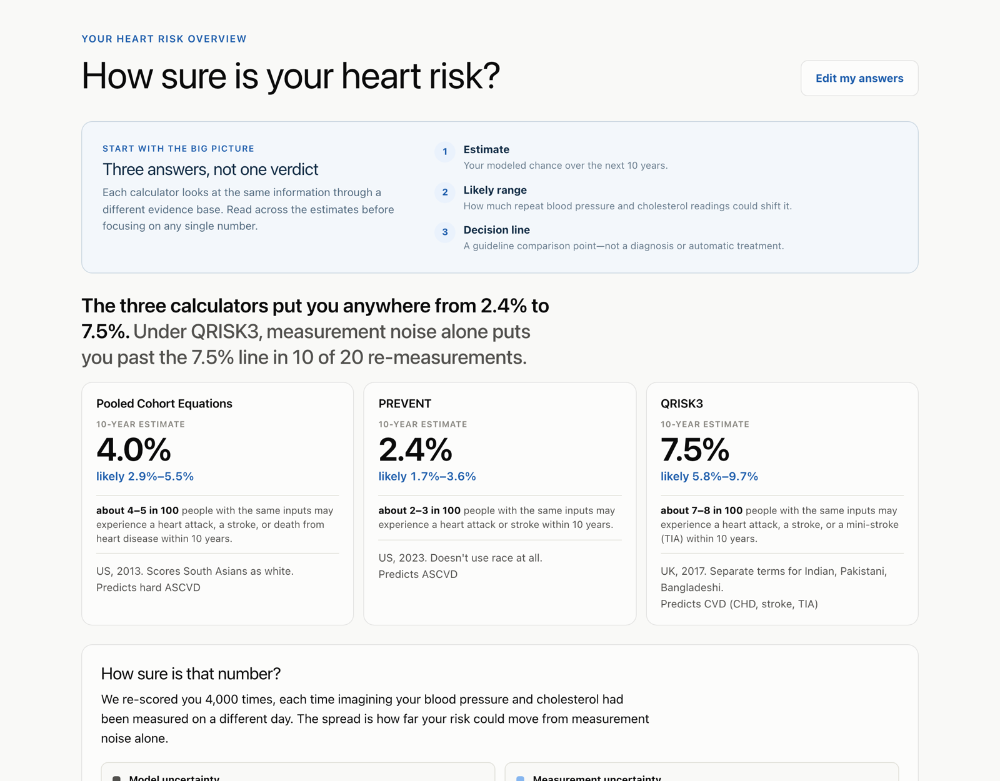
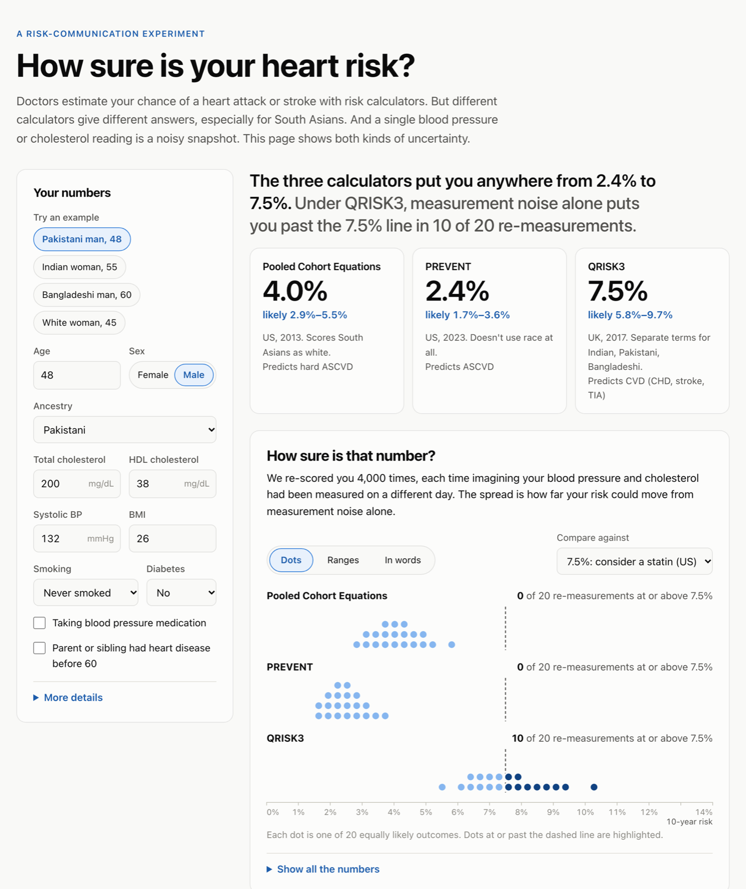
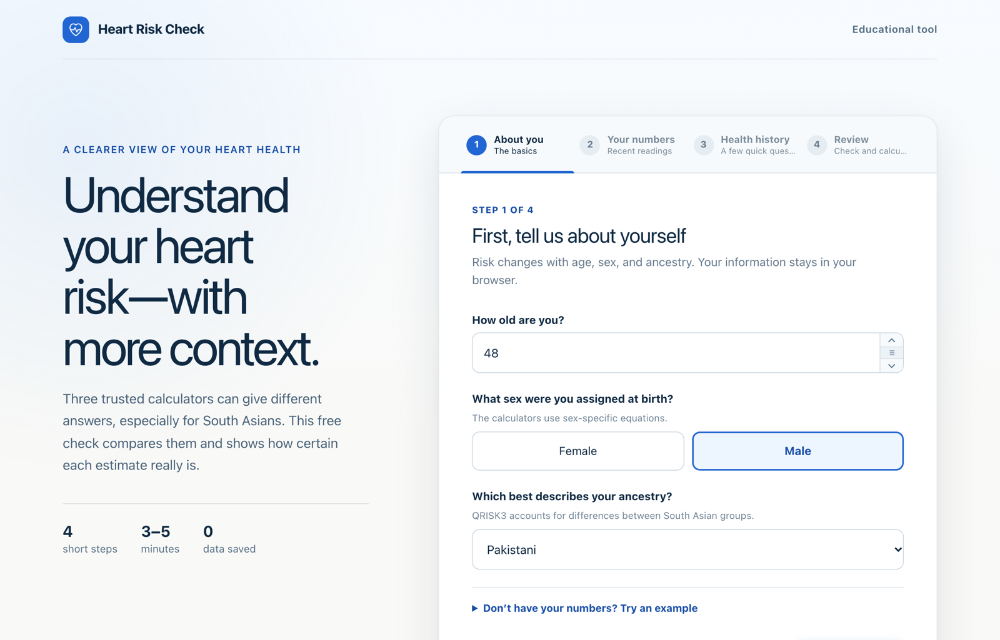
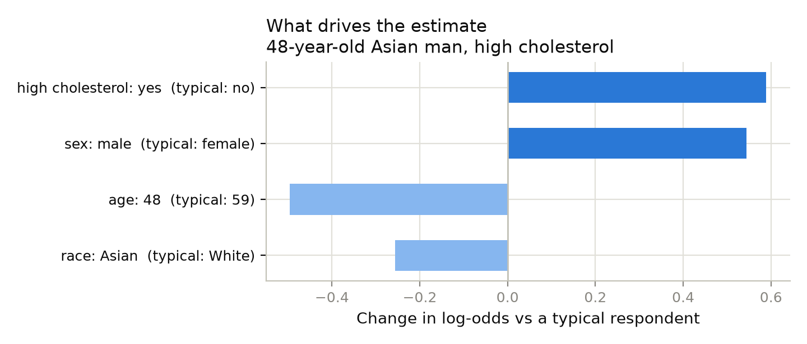

# Case study: How sure is your heart risk?

**[Live app](https://anika-lakhani.github.io/south-asian-heart-risk/)** · **[Code](https://github.com/Anika-Lakhani/south-asian-heart-risk)** · **[Model card](../ml/MODEL_CARD.md)**

> **In short:** Heart-risk calculators give South Asians wildly different answers, and a
> single clinic reading can't say which side of a treatment threshold you're on. I built a
> tool that makes both kinds of uncertainty visible, grounded in published clinical models
> and HCI research on how people read uncertainty. Then I tested what standard US survey data
> would have said instead, and it got South Asians backwards.

## The problem

People of South Asian descent develop heart disease earlier and at higher rates than most
groups, often without the classic risk profile. But the calculators clinicians use don't
agree about them:

- The **Pooled Cohort Equations**, the standard US calculator, were built only on white and
  African American adults. Everyone else is scored as white.
- **PREVENT**, the AHA's 2023 replacement, removes race entirely.
- **QRISK3**, from the UK, has separate terms for Indian, Pakistani, and Bangladeshi patients.

For one 48-year-old Pakistani man with ordinary numbers, the three give **4.0%, 2.4%, and
7.5%**. Same person, same day: a threefold spread.

There's a second, quieter uncertainty. Blood pressure varies by roughly 12 mmHg from visit to
visit, so one reading is a noisy snapshot. When I re-score that same man under 4,000
plausible re-measurements, QRISK3 puts him past the 7.5% statin-discussion line in **10 of 20**
outcomes. Whether he "should talk to a doctor about a statin" is a coin flip, and no
calculator tells him that.

## Where this started

This began in Fall 2024 as a Harvard CS 2790r (HCI) project with Sanjna Kedia and Krisha Patel.
Our question: **how should risk uncertainty be shown to patients so they understand it and
keep trusting it?** We drew on research showing that static error bars are routinely
misread, while frequency framings like quantile dotplots help people make better decisions
(Kay et al. 2016; Fernandes et al. 2018) and maintain trust over time (Yang et al. 2024).

The semester ended with a prototype that didn't work. The questionnaire ran, but the risk
score was a stub that always returned zero, and its "South Asian adjustment" was a guessed
×1.5 multiplier. In late 2026 I rebuilt it from scratch.

## Design principles

1. **Show the disagreement instead of picking a winner.** Three answers side by side, each
   labeled with who it was built on, rather than one authoritative-looking number.
2. **Frequencies over percentages.** "About 7–8 in 100 people with the same inputs" and
   "10 of 20 re-measurements" are things people can picture and count.
3. **Never adjust the numbers to feel better.** Some research "corrects" probabilities toward
   how people perceive them. For health, people deserve their actual numbers, so every
   probability is shown exactly as computed.
4. **Separate the two uncertainties.** *Model uncertainty* (the calculators disagree) and
   *measurement uncertainty* (any one reading is noisy) have different causes and different
   remedies, so the results page names them separately.
5. **Every number traceable to a source.** No invented models. Each calculator is implemented
   from its published equations and tested against its authors' own reference values.

## Key decisions

### Published equations instead of a homemade model

The old prototype's ×1.5 multiplier was indefensible. Instead, I implemented the three
calculators clinicians actually use and verified them: PCE against the 2013 guideline's worked
example, PREVENT against the paper's supplement, and QRISK3 against **48 profiles scored by
its authors' original code**. The disagreement between them *is* the finding, so it has to be
real.

### Quantile dotplots for measurement noise

Error bars invite people to read the middle and ignore the rest. A quantile dotplot shows 20
equally likely outcomes as dots, and highlights the ones past the treatment threshold. "Half
the dots are past the line" is immediately legible. Users can switch to interval bands or a
plain-language summary, because the original study design called for comparing all three.

### Streamlit → a static web app

My first version was a Streamlit app, chosen mostly because the models were in Python. When I
evaluated that choice for a portfolio aimed at product and HCI work, it fell short. Streamlit
reruns the whole page on every slider move, which rules out the live, animated interactions
this project is about, and free Streamlit apps go to sleep, so a recruiter's first click
could land on a loading screen.

I rebuilt it as a static React + TypeScript app with hand-drawn SVG charts on GitHub Pages:
under 90 KB, instant load, and never asleep. That meant the models now existed in two
languages, so I made Python the single source of truth. A script generates the TypeScript
coefficient tables plus 300 random test profiles, and the TypeScript models must match
Python on every one to 12 decimal places, or CI fails.

### Redesigning the experience

The first web version put every input and every chart on one screen. It was accurate but
overwhelming: a form beside a wall of results. I redesigned it in Figma Make around a simple
idea: **guide people in, then teach them how to read the answer.**

- **A four-step intake** with plain-language questions ("How old are you?", "Do you smoke?")
  and hints for each number ("The top number in your reading"), drag-to-adjust steppers, and a
  BMI calculator for people who don't know theirs.
- **A results page that opens with how to read it**, "Three answers, not one verdict", before
  showing any number.
- **Natural frequencies on every estimate**, and a key separating model from measurement
  uncertainty.

Two smaller decisions mattered for trust. The design originally included a "share my data to
help others" checkbox, but no database existed. In a health tool, a privacy promise you can't
keep is worse than none, so I replaced it with a plain statement that nothing leaves the
browser. I'm now building the real version: an opt-in donation flow that feeds an open,
anonymized dataset with real South Asian categories. It asks first whether someone has had a
heart event (the calculators don't apply if so), anonymizes answers in the browser, and stays
hidden until the database behind it exists. I also made sure the whole flow works in dark mode, on phones, and with reduced
motion, and that every chart has a text description and a table equivalent.

 

## What standard US data would have said

I also trained a model on the CDC's 2025 BRFSS survey (273,266 US adults, with survey weights)
to see what a "standard" data-driven approach would tell a user. The model card has the
details. A few choices mattered:

- **It measures prevalence, not future risk**, since BRFSS is a one-time survey. Because that
  isn't comparable to the 10-year calculators, the model is deliberately **not** in the app.
- **Risk factors only.** Medications and self-rated health were excluded because people change
  them *after* a heart attack. Including them would have inflated accuracy by leaking the
  answer.
- **I didn't drop incomplete answers**, because doing so would have removed non-white
  respondents disproportionately.
- **A simple, explainable model was enough.** Logistic regression matched gradient boosting
  (AUROC 0.822 vs 0.823) while splitting every estimate exactly into one contribution per
  answer.

The result made the case for the project better than I could have:

**In US survey data, being Asian *lowers* the estimate.** BRFSS pools all Asian Americans into
one category that is mostly East and Southeast Asian, so South Asian risk gets averaged away. A
model trained on standard US data would tell a South Asian user their ancestry is protective,
the opposite of what QRISK3 and the clinical research say. The subgroup audit found a related
problem: the model under-predicts for American Indian / Alaska Native and Black respondents,
the kind of error that matters most in a risk tool.

## Quality

- **450 automated tests**: published reference values for all three calculators, Python-to-
  TypeScript parity, the BRFSS recoding rules, and full intake-to-results interaction tests.
- **CI on every push** runs both suites, then builds and deploys the site.
- **Licensing handled properly.** QRISK3 is LGPL, so those files carry that license and the
  disclaimer ClinRisk requires wherever its scores appear.

## What I'd do next

1. **A small usability study.** The original project was a user study. Five participants, one
   example profile each, three questions: *What's your risk? How sure is it? Would you talk to
   a doctor?* The measure that matters is whether people read the dotplot correctly.
2. **South Asian-specific data.** The MASALA study follows South Asian Americans specifically
   and would let me test calibration for the group this tool is about.
3. **Clinician input** on whether the results page would help or hinder a real conversation
   about statins.

---

*Built with Claude Code as a pair programmer. Interface designed in Figma Make. Origin
project with Sanjna Kedia and Krisha Patel, Harvard CS 2790r, Fall 2024.*
