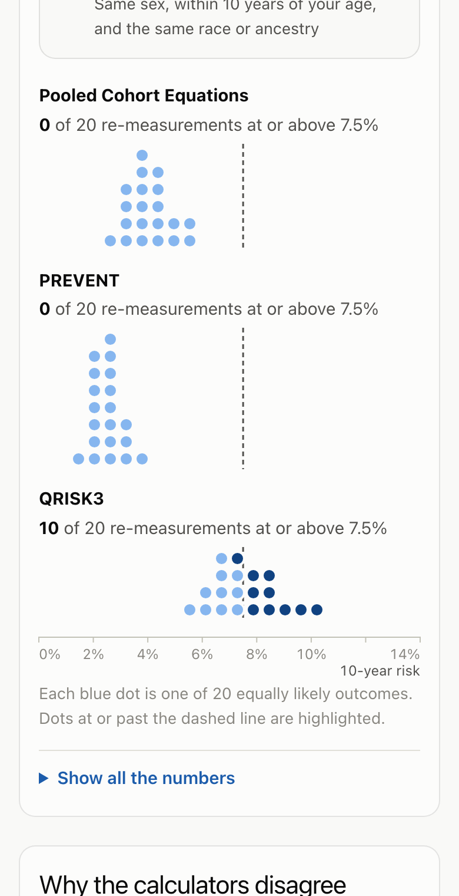
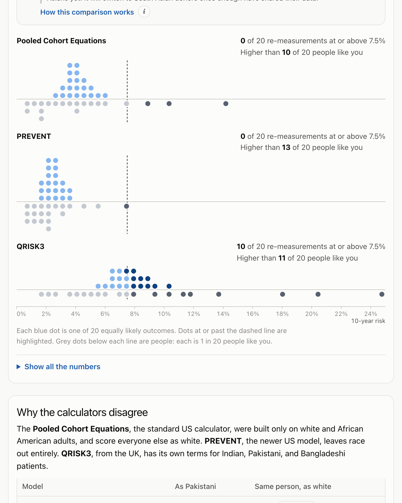
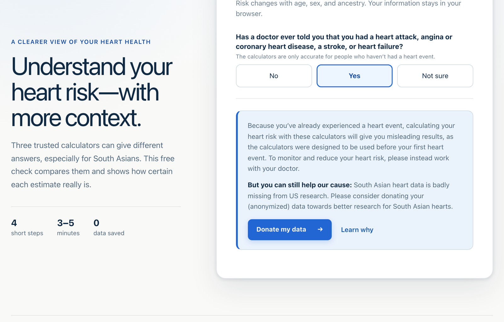
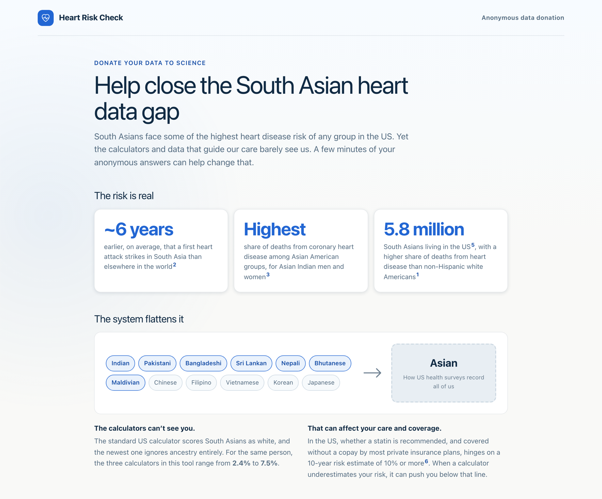

# Case study: How sure is your heart risk?

**[Live app](https://anika-lakhani.github.io/south-asian-heart-risk/)** · **[Code](https://github.com/Anika-Lakhani/south-asian-heart-risk)** · **[Model card](../ml/MODEL_CARD.md)**

> **In short:** Heart-risk calculators give South Asians wildly different answers, and a
> single clinic reading can't say which side of a treatment threshold you're on. I built a
> tool that makes both kinds of uncertainty visible, grounded in published clinical models
> and HCI research on how people read uncertainty, and lets people compare themselves with
> others like them. Then I tested what standard US survey data would have said instead, and
> it got South Asians backwards, so I built a way to collect the data that's missing.

## The problem

People of South Asian descent develop heart disease earlier and at higher rates than most
groups, often without the classic risk profile. But the calculators clinicians use don't
agree about them:

- The **Pooled Cohort Equations**, the standard US calculator, were built only on white and
  African American adults. Everyone else is scored as white.
- **PREVENT**, the AHA's 2023 replacement, removes race entirely.
- **QRISK3**, from the UK, has separate terms for Indian, Pakistani, and Bangladeshi patients.

For one 48-year-old Pakistani man with ordinary numbers, the three give **4.0%, 2.4%, and
7.5%**. Same person, same day: a threefold spread.

There's a second, quieter uncertainty. Blood pressure varies by roughly 12 mmHg from visit to
visit, so one reading is a noisy snapshot. When I re-score that same man under 4,000
plausible re-measurements, QRISK3 puts him past the 7.5% statin-discussion line in **10 of 20**
outcomes. Whether he "should talk to a doctor about a statin" is a coin flip, and no
calculator tells him that.

## Where this started

This began in Fall 2024 as a Harvard CS 2790r (HCI) project with Sanjna Kedia and Krisha Patel.
Our question: **how should risk uncertainty be shown to patients so they understand it and
keep trusting it?** We drew on research showing that static error bars are routinely
misread, while frequency framings like quantile dotplots help people make better decisions
(Kay et al. 2016; Fernandes et al. 2018) and maintain trust over time (Yang et al. 2024).

The semester ended with a prototype that didn't work. The questionnaire ran, but the risk
score was a stub that always returned zero, and its "South Asian adjustment" was a guessed
×1.5 multiplier. In late 2026 I rebuilt it from scratch.

## Design principles

1. **Show the disagreement instead of picking a winner.** Three answers side by side, each
   labeled with who it was built on, rather than one authoritative-looking number.
2. **Frequencies over percentages.** "About 7–8 in 100 people with the same inputs" and
   "10 of 20 re-measurements" are things people can picture and count.
3. **Never adjust the numbers to feel better.** Some research "corrects" probabilities toward
   how people perceive them. For health, people deserve their actual numbers, so every
   probability is shown exactly as computed.
4. **Separate the two uncertainties.** *Model uncertainty* (the calculators disagree) and
   *measurement uncertainty* (any one reading is noisy) have different causes and different
   remedies, so the results page names them separately.
5. **Every number traceable to a source.** No invented models. Each calculator is implemented
   from its published equations and tested against its authors' own reference values.

## Key decisions

### Published equations instead of a homemade model

The old prototype's ×1.5 multiplier was indefensible. Instead, I implemented the three
calculators clinicians actually use and verified them: PCE against the 2013 guideline's worked
example, PREVENT against the paper's supplement, and QRISK3 against **48 profiles scored by
its authors' original code**. The disagreement between them *is* the finding, so it has to be
real.

### Quantile dotplots for measurement noise

Error bars invite people to read the middle and ignore the rest. A quantile dotplot shows 20
equally likely outcomes as dots, and highlights the ones past the treatment threshold. "Half
the dots are past the line" is immediately legible. Users can switch to interval bands or a
plain-language summary, because the original study design called for comparing all three.

### Streamlit → a static web app

My first version was a Streamlit app, chosen mostly because the models were in Python. When I
evaluated that choice for a portfolio aimed at product and HCI work, it fell short. Streamlit
reruns the whole page on every slider move, which rules out the live, animated interactions
this project is about, and free Streamlit apps go to sleep, so a recruiter's first click
could land on a loading screen.

I rebuilt it as a static React + TypeScript app with hand-drawn SVG charts on GitHub Pages:
under 90 KB, instant load, and never asleep. That meant the models now existed in two
languages, so I made Python the single source of truth. A script generates the TypeScript
coefficient tables plus 300 random test profiles, and the TypeScript models must match
Python on every one to 12 decimal places, or CI fails.

### Redesigning the experience

The first web version put every input and every chart on one screen. It was accurate but
overwhelming: a form beside a wall of results. I redesigned it in Figma Make around a simple
idea: **guide people in, then teach them how to read the answer.**

- **A four-step intake** with plain-language questions ("How old are you?", "Do you smoke?")
  and hints for each number ("The top number in your reading"), drag-to-adjust steppers, and a
  BMI calculator for people who don't know theirs.
- **A results page that opens with how to read it**, "Three answers, not one verdict", before
  showing any number.
- **Natural frequencies on every estimate**, and a key separating model from measurement
  uncertainty.
- **Each calculator explains itself.** Pointing at a result card reveals, in plain language,
  how that calculator builds its number and what it assumes: PCE has only white and African
  American versions, so it scores South Asians as white; PREVENT leaves race out on purpose,
  so it can't see South Asian risk either; QRISK3 assumes UK care and counts mini-strokes,
  so it runs higher. Showing the disagreement only helps if people can see *why* the
  calculators disagree. Hover doesn't exist on phones or for keyboard users, so the same
  panel also opens from a small ⓘ button that works by tap, keyboard, and screen reader.

Accessibility wasn't an afterthought: the whole flow works in dark mode, on phones, and with
reduced motion, and every chart has a text description and a table equivalent.

 

## "Is that normal for someone like me?"

A 10-year risk of 7.5% means little without a reference point. The natural next question is
how it compares with people like you, so the results page has a **"Compare with people like
you"** option: same sex, within 10 years of your age, and the same race or ancestry.

**The data had to be measured, not self-reported.** To compare fairly, every peer has to be
scored by the same three calculators, which needs real blood pressure and cholesterol. BRFSS,
which I'd used for the ML analysis, doesn't have those. NHANES does: CDC staff measure blood
pressure and draw blood from a nationally representative sample. I pooled the two most recent
cycles (2017–2023) for about 10,000 adults, kept only people who'd never had a heart attack
or stroke (the calculators' own rule), and used the survey weights so each group reflects the
US population. The browser scores peers with the exact model code it uses for you.

**It runs into the same wall, and says so.** NHANES also pools all Asian Americans together,
so a Pakistani man is compared with 210 Asian American men aged 38–58, and the page tells him
that plainly. This is where the donation project pays off: once at least 30 donors match
someone's sex, age, and ancestry, the comparison switches to them automatically. Donating
your data directly improves what the next person sees. It only reads the public, anonymized
release, never the private database.

**Holding one thing constant on purpose.** Peers are scored with *your* ancestry setting. The
alternative, guessing which Asian American peers are South Asian, would be invented data. This
way the comparison isolates what people can actually act on: blood pressure, cholesterol,
smoking, diabetes, weight, and kidney function.

**One chart, not two.** The first version put peers in a separate grey row under each
calculator. That doubled the page length and forced the eye to jump between rows. The final
version draws both on one chart: your 20 re-measurements stack above a shared baseline and
20 peers (each 1 in 20 people like you) hang below it, so both are read against the same axis
and threshold. In the ranges view, peers are a quiet grey track behind your blue bands. It's
the same quantile-dotplot idea as the rest of the app, just mirrored.

**A test caught a real bug.** My first weighted-percentile function used a midpoint rule that
picked the wrong person when one participant carried most of the weight. A two-person test
case exposed it before it shipped.

## What standard US data would have said

I also trained a model on the CDC's 2025 BRFSS survey (273,266 US adults, with survey weights)
to see what a "standard" data-driven approach would tell a user. The model card has the
details. A few choices mattered:

- **It measures prevalence, not future risk**, since BRFSS is a one-time survey. Because that
  isn't comparable to the 10-year calculators, the model is deliberately **not** in the app.
- **Risk factors only.** Medications and self-rated health were excluded because people change
  them *after* a heart attack. Including them would have inflated accuracy by leaking the
  answer.
- **I didn't drop incomplete answers**, because doing so would have removed non-white
  respondents disproportionately.
- **A simple, explainable model was enough.** Logistic regression matched gradient boosting
  (AUROC 0.822 vs 0.823) while splitting every estimate exactly into one contribution per
  answer.

The result made the case for the project better than I could have:

**In US survey data, being Asian *lowers* the estimate.** BRFSS pools all Asian Americans into
one category that is mostly East and Southeast Asian, so South Asian risk gets averaged away. A
model trained on standard US data would tell a South Asian user their ancestry is protective,
the opposite of what QRISK3 and the clinical research say. The subgroup audit found a related
problem: the model under-predicts for American Indian / Alaska Native and Black respondents,
the kind of error that matters most in a risk tool.

## Building the data that's missing

The redesign included a "share my data to help others" checkbox, but nothing behind it: no
database, no consent flow, no privacy policy. In a health tool, a privacy promise you can't
keep is worse than none, so I removed it, then built the real thing.

**It starts with a validity fix.** The first question is now whether someone has ever had a
heart attack, angina, stroke, or heart failure. PCE, PREVENT, and QRISK3 were all built on
people who hadn't, so a "yes" means any score would mislead. Those users get an explanation
instead of a number, and an invitation to contribute their data.

**The ask is persuasive without guilt.** Instead of a bare opt-in, a short page explains why the
data matters, with every statistic cited: South Asians' first heart attacks come about six
years earlier, the standard calculator scores them as white, and 0.17% of the NIH budget went
to research on Asian Americans and Pacific Islanders over 26 years. A diagram shows twelve
distinct groups collapsing into a single "Asian" box. The consent box starts unchecked, and
saying no is a neutral "Back to my results".

The first version of that page was accurate but dense: every statistic came with a full
paragraph. I reworked it into a scannable infographic. Each box shows only a headline and a
big number or diagram ("~6 years earlier", "2.4% ↔ 7.5%", "10%"), and the full explanation and
citation appear on hover or tap. The test I held it to was that someone who never hovers
still gets the whole argument.

**Privacy is enforced in three places, so one failure doesn't expose anyone:**

- **In the browser:** exact age becomes a 5-year band, and nothing identifying is ever asked.
- **In the database:** the public website can only *add* rows, never read them. The database
  records only the month a donation arrived, and a bot check verifies each submission on the
  server before it's saved.
- **At release:** every combination of age band, sex, ancestry, and region must describe at
  least 5 people, and rare combinations are coarsened step by step.

**The order of those steps is a values decision.** My first version coarsened rare South Asian
groups first, but that detail is the dataset's whole reason for existing. Reordering so region
and age give way first took the share of donors who could be released at a 600-person sample
from 50% to about 94%, and kept far more Sri Lankan and Nepali donors' exact ancestry.

**I tested the security the way an attacker would.** Against the live database, with the
website's public key, I tried to read, change, delete, backdate, and flood it. Every attempt
was refused, and valid donations still saved. Two real bugs surfaced along the way, both now
covered by tests: a local settings file briefly let the test suite send a row to the real
database, and a Supabase permission default blocked the release script with a 403.

Everything is documented in plain language: a [privacy notice](https://anika-lakhani.github.io/south-asian-heart-risk/#privacy),
a [data dictionary](DATA_DICTIONARY.md) for researchers, and an end-to-end
[explainer](DONATIONS.md) that's candid about what it doesn't protect against.

## Quality

- **506 automated tests**: published reference values for all three calculators, Python-to-
  TypeScript parity, the BRFSS and NHANES recoding rules, survey-weighted peer percentiles,
  every intake and donation path, the bot-check function, and the release script's
  anonymization guarantee.
- **Security rules tested twice**: in a local Postgres and against the live database.
- **CI on every push** runs both suites, then builds and deploys the site.
- **Licensing handled properly.** QRISK3 is LGPL, so those files carry that license and the
  disclaimer ClinRisk requires wherever its scores appear.

## What I'd do next

1. **A small usability study.** The original project was a user study. Five participants, one
   example profile each, three questions: *What's your risk? How sure is it? Would you talk to
   a doctor?* The measure that matters is whether people read the dotplot correctly,
   including the mirrored "people like you" version. It would also show whether the donation
   page persuades without pressuring.
2. **Recruit donors through community partners**: South Asian student associations, community
   organizations, and places of worship. The dataset becomes useful at a few hundred donors,
   and the "people like you" comparison can then use South Asian peers instead of all Asian
   Americans.
3. **South Asian-specific data.** The MASALA study follows South Asian Americans specifically
   and would let me test calibration for the group this tool is about.
4. **Clinician input** on whether the results page would help or hinder a real conversation
   about statins.

---

*Built with Claude Code as a pair programmer. Interface designed in Figma Make. Origin
project with Sanjna Kedia and Krisha Patel, Harvard CS 2790r, Fall 2024.*
