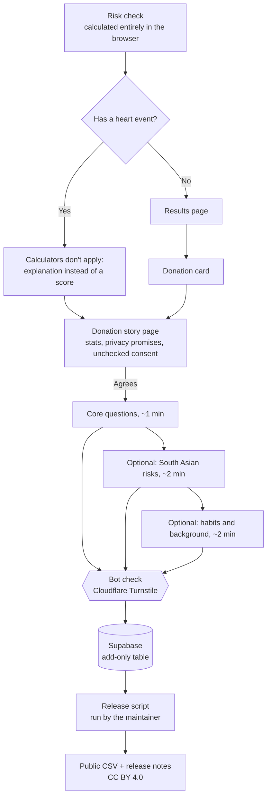
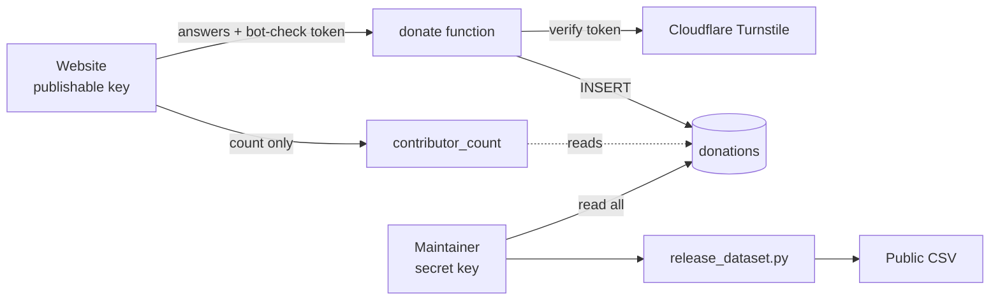

# How data donation works

This explains, end to end, how the app collects anonymous donations, protects them, and turns
them into an open dataset. It's written for contributors, researchers, and anyone deciding
whether to trust the project with their answers.

- **For donors:** the [privacy notice](https://anika-lakhani.github.io/south-asian-heart-risk/#privacy)
  is the plain-language version.
- **For researchers:** the [data dictionary](DATA_DICTIONARY.md) defines every released field.

## Why it exists

US health surveys record all Asian Americans as one group, so South Asian heart risk is
averaged away. In our own [analysis](../ml/MODEL_CARD.md) of 273,266 survey respondents, that
pooled category made Asian ancestry look *protective*, the opposite of what clinical research
on South Asians shows. Donations build an open dataset with real South Asian categories and a
few things national surveys don't ask: age at a first heart event, years since immigrating,
and risks common in South Asian communities (waist size, chewing tobacco, Lp(a)).

## The flow

Key properties:

- **The risk check never sends anything.** Donating is a separate, explicit choice after the
  results, behind a checkbox that starts unchecked.
- **Each section is saved on its own.** Stopping partway still keeps what was finished.
- **People who've had a heart event are never given a misleading score.** PCE, PREVENT, and
  QRISK3 are only valid before a first event, so those users get an explanation and can
  donate instead.

## Three layers of anonymization

Privacy is enforced at three separate points, so a failure in one doesn't expose people.

### 1. In the browser, before anything is sent

[`web/src/lib/donation.ts`](../web/src/lib/donation.ts) builds what's sent:

- **Exact age becomes a 5-year band** (`45-49`), and BMI is rounded.
- **No name, email, phone, address, or account** is ever asked for.
- **A random ID** (generated with `crypto.randomUUID()`) links one person's sections. It isn't
  derived from anything about them.
- **Region is broad** (US Northeast / Midwest / South / West, Canada, UK, elsewhere), never a
  city or state.

### 2. In the database, when it's stored

[`supabase/schema.sql`](../supabase/schema.sql) defines a single `donations` table:

| Column | What it holds |
|---|---|
| `donation_id` | The random ID from the browser |
| `module` | `core`, `southAsian`, or `context` |
| `answers` | That section's answers, as JSON |
| `app_version` | The build that sent it; `test…` marks test entries |
| `received_month` | **Month only**, set by the database, so exact times are never stored |

### 3. At release, before anything is public

[`scripts/release_dataset.py`](../scripts/release_dataset.py) applies **k-anonymity with
k = 5**: every combination of the fields someone could use to recognize a person (age band,
sex, ancestry, region) must describe at least 5 donors. Only rows in rarer combinations are
coarsened, one step at a time, **least valuable detail first**:

1. Region → `us` / `non_us`
2. Age → 10-year bands
3. Region → `not_released`
4. Sri Lankan, Nepali, Bhutanese, Maldivian → `south_asian_other`
5. Age → broad bands (30–49, 50–64, 65–84)

Anyone still in a group smaller than 5 is **withheld**. South Asian subgroup detail goes last
because it's the dataset's reason for existing. The script also:

- **removes test entries;**
- **issues fresh random IDs and shuffles row order** in every release, so rows can't be
  linked across releases or ordered by arrival;
- **refuses to publish fewer than 30 rows.**

## Storage and access

**The bot check.** Each section is sent to a small server function,
[`supabase/functions/donate`](../supabase/functions/donate/index.ts), together with a
single-use token from Cloudflare Turnstile. The function asks Cloudflare whether the token is
genuine (without forwarding the visitor's IP), validates the answers' shape, and only then
saves the row. Once [`004_require_bot_check.sql`](../supabase/004_require_bot_check.sql) has
run, the website's key can no longer insert directly, so the function is the only way in.
Turnstile's script loads only on the donation screens, never during the risk check.

- **The website uses the publishable key**, which is designed to be public. With the bot check
  enabled, it can do only two things: call the `donate` function, and call
  `contributor_count()`. Reading, changing, deleting, and direct inserts are all denied. Row
  Level Security is on, and inserts are only granted on four columns, so not even the function
  can set the date.
- **The secret key** can read everything. It lives only in Supabase and in the maintainer's
  terminal when running a release. It never appears in the website, the repo, or any chat.
- **The public count** (`contributor_count()`) returns only a number, excludes test entries,
  and is shown on the site only once there are at least 10 donors.
- **Host logs.** Like any web host, Supabase keeps access logs, which can include IP
  addresses, for one day on the free plan. They're never stored with or linked to answers.

## Operating it

| Task | How |
|---|---|
| **Turn donations on** | Set the `VITE_SUPABASE_URL` and `VITE_SUPABASE_KEY` repository variables (GitHub → Settings → Secrets and variables → Actions → Variables), then re-run the latest workflow. |
| **Turn donations off** | Delete `VITE_SUPABASE_URL`, then re-run the workflow. The donation card and links disappear; nothing else changes. |
| **Turn on the bot check** | 1) Create a Turnstile widget in Cloudflare for `anika-lakhani.github.io` and `localhost`. 2) In Supabase, create the `donate` Edge Function from [`index.ts`](../supabase/functions/donate/index.ts), turn off "Verify JWT", and add the `TURNSTILE_SECRET_KEY` secret. 3) Set the `VITE_TURNSTILE_SITE_KEY` repository variable and re-run the workflow. 4) After a successful test donation, run [`004_require_bot_check.sql`](../supabase/004_require_bot_check.sql). |
| **Try the flow without saving** | Open the site with `?donate=preview`. A banner confirms nothing is sent. |
| **Publish a release** | See [Publishing a data release](../README.md#publishing-a-data-release). Review the CSV and notes before committing them. |
| **First-time setup for releases** | Run [`supabase/003_release_reader.sql`](../supabase/003_release_reader.sql) once. With "Automatically expose new tables" off, even the secret key needs an explicit read grant; without it, releases fail with HTTP 403. |
| **Check the connection** | `python scripts/release_dataset.py --min-rows 0 --name dry-run` with the secret key set. It should report 0 real donations if only tests exist. Delete the `dry-run` folder afterwards. |
| **Remove test rows** (optional) | In Supabase's Table Editor, filter `app_version` starting with `test` and delete them. Releases and the count ignore them anyway. |
| **Rotate a leaked key** | In Supabase → Project Settings → API Keys, create a new key and revoke the old one. For the publishable key, also update the repository variable. |
| **Develop locally** | Put the URL, the publishable key, and `VITE_APP_VERSION=test-local` in `web/.env.development.local` (git-ignored). Test runs can never reach the database. |

## What this protects against, and what it doesn't

**Protected:**

- **Someone reading or tampering with donations** through the public website or API.
- **Fake or junk rows** in the wrong shape: unknown sections, malformed or oversized answers,
  and duplicate submissions are rejected by the database.
- **Singling someone out in a release**, by name, contact details, exact age or date, or a
  rare combination of age, sex, ancestry, and region.
- **Test data leaking** into the public count or a release.

**Not fully protected (known limits):**

- **Other fields can still be distinctive.** k-anonymity covers the four fields most likely
  to identify someone. A very unusual combination of other answers (say, an exact age at a
  first heart attack plus specific lab values) could still narrow things down. Adding more
  fields to the k-anonymity check would cost a lot of detail, so this is a deliberate
  trade-off worth revisiting as the dataset grows.
- **Determined fake answers.** The bot check stops automated submissions, but a person can
  still type made-up answers by hand. Each release's notes are the place to flag suspicious
  patterns.
- **Withdrawal.** Because donations are anonymous, a specific person's answers can't be found
  afterward, so they can't be removed. The privacy notice says this up front.
- **Representativeness.** Donors choose to take part, so the dataset describes the people who
  use the app, not any population. The data dictionary says so.
- **Legal review.** The design aims to keep released data de-identified, which matters under
  health-privacy laws such as Washington's My Health My Data Act. It hasn't been reviewed by
  a lawyer.

## How it's tested

| Layer | Tests |
|---|---|
| **App flow** | [`web/src/App.test.tsx`](../web/src/App.test.tsx) walks every path in a simulated browser: the heart-history branch, consent gating, every optional section, and preview mode sending nothing. |
| **Browser anonymization** | [`web/src/lib/donation.test.ts`](../web/src/lib/donation.test.ts): age bands, and a guard that tests can never be in live mode. |
| **Database rules** | Tested in Postgres 18 (PGlite) and against the live project with the publishable key: reading, updating, deleting, backdating, read-back, unknown sections, oversized or malformed answers, and duplicates are all refused; a valid insert and the count work. |
| **Bot-check function** | [`web/src/donateFunction.test.ts`](../web/src/donateFunction.test.ts): saves only after Cloudflare confirms the token, never forwards the IP or stores the token, rejects malformed input before contacting Cloudflare, and only allows the app's own sites. The lockdown SQL is tested in PGlite: direct inserts are refused afterward, while the function's role can insert but not backdate. |
| **Release script** | [`tests/test_release.py`](../tests/test_release.py): test exclusion, section merging, unit conversion, fresh IDs, the 30-row minimum, the order of generalization, and the k ≥ 5 guarantee on 600 random donors. |
| **Live site** | Checked after deploying: the donation card appears, consent starts unchecked, and the site's browser origin is allowed to reach the database. |
