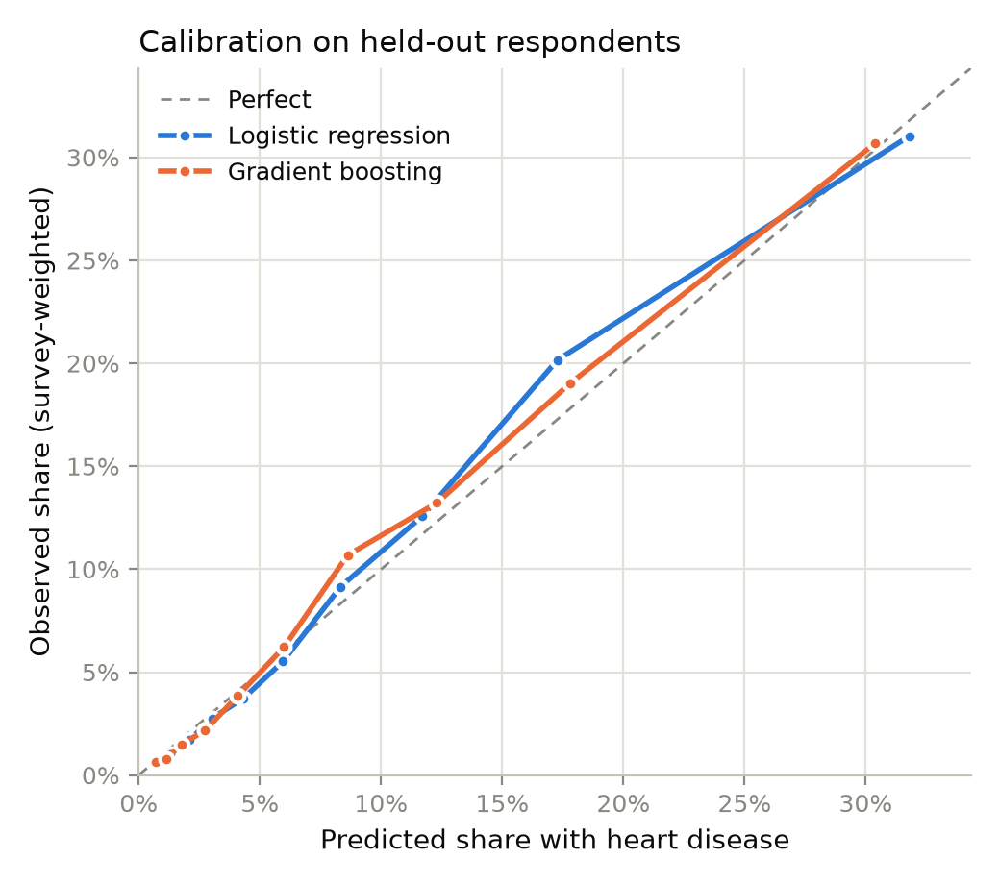
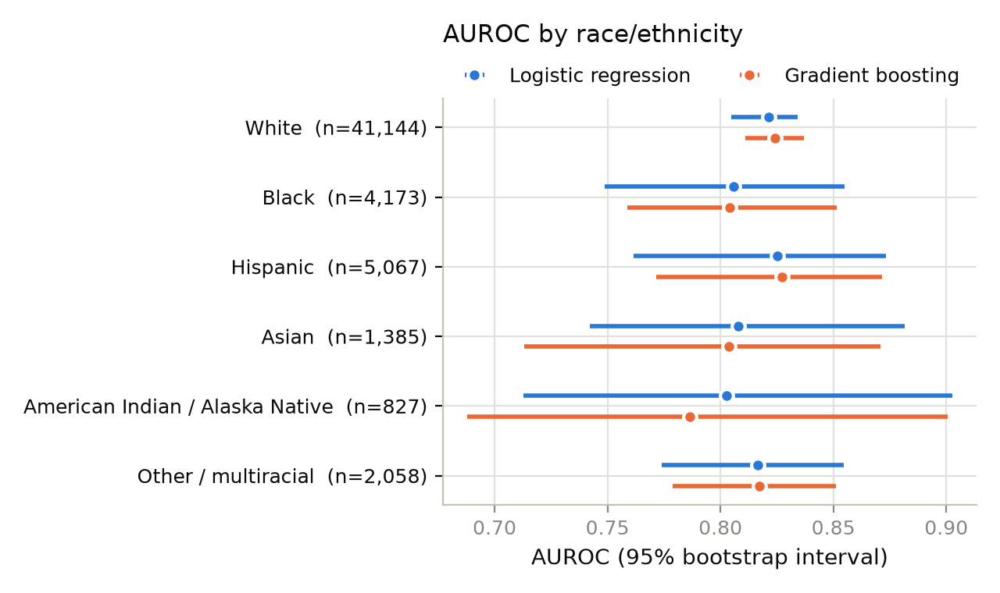
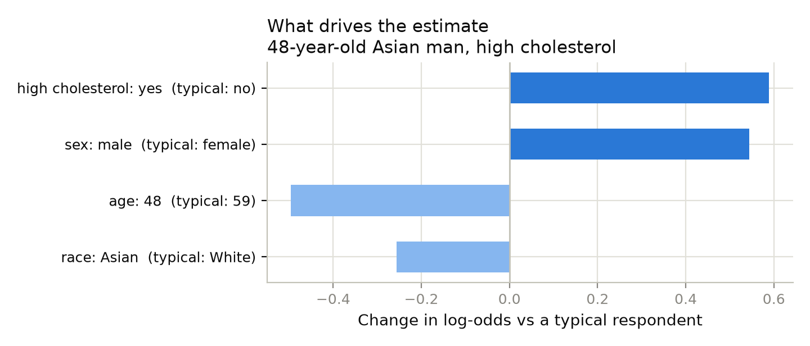

# Model card: self-reported heart disease (BRFSS 2025)

> Generated by [`ml/train.py`](train.py) from [`reports/metrics.json`](reports/metrics.json).
> Edit the template in `train.py`, not this file.

## What it predicts, and what it doesn't

The model estimates the share of US adults with a given risk profile who report
**having ever been told they had a heart attack or coronary heart disease**
(BRFSS variable `_MICHD`).

That is **prevalence, not future risk.** BRFSS is a one-time survey, so it can't
say who will develop heart disease over the next 10 years. The model's numbers
are therefore **not comparable** to the PCE, PREVENT, or QRISK3 estimates in the
app, and the app doesn't show them. The model is an analysis of what population
survey data can and can't tell us, especially about South Asians.

## Data

- **Source:** CDC Behavioral Risk Factor Surveillance System, 2025 public file
  (telephone survey of US adults).
- **Population:** respondents aged 30–79 with an answer to the outcome question:
  273,266 people. 80/20 random split, stratified by outcome and race:
  218,612 training, 54,654 held out.
- **Survey weights** (`_LLCPWT`) are used in training and every metric, so results
  describe US adults rather than just the people who answered. Weighted share
  reporting heart disease: 7.1%.
- **Missing answers:** "don't know" for smoking, blood pressure, and cholesterol is
  kept as its own category, and missing BMI is imputed with a missing-value flag.
  Dropping incomplete rows instead would have removed 20% of respondents, and
  removed non-white respondents more often (Asian respondents 24.5% vs white
  19.1%).

**Features:** age, sex, race/ethnicity, BMI, smoking, diabetes, ever told high
blood pressure, ever told high cholesterol, kidney disease, physical activity.

**Deliberately excluded:** general health rating, stroke history, and blood
pressure or cholesterol medication. People often start these medications, or
rate their health lower, *after* a heart attack. Including them would make the
model look better by learning the consequences of heart disease, not its risk
factors. The same reverse causation can't be fully removed from "ever told high
cholesterol/blood pressure", which is the most important caveat on these results.

## Results on held-out respondents

| | Logistic regression | Gradient boosting |
|---|---|---|
| AUROC (95% CI) | 0.822 (0.809–0.834) | 0.823 (0.810–0.834) |
| Average precision | 0.280 | 0.278 |
| Brier score | 0.0590 | 0.0591 |
| Mean predicted vs observed | 7.2% vs 7.3% | 7.0% vs 7.3% |

**The logistic regression is the chosen model.** It's additive, so every
person's estimate splits exactly into one contribution per answer, and it's
small enough to run in a browser. Gradient boosting adds little on this data;
see the table above.

### By race/ethnicity (logistic regression)

| Group | Held-out n | AUROC (95% CI) | Observed | Mean predicted |
|---|---|---|---|---|
| White | 41,144 | 0.821 (0.805–0.834) | 7.5% | 7.7% |
| Black | 4,173 | 0.806 (0.749–0.855) | 7.9% | 6.9% |
| Hispanic | 5,067 | 0.825 (0.762–0.873) | 5.9% | 5.5% |
| Asian | 1,385 | 0.808 (0.742–0.881) | 2.8% | 3.8% |
| American Indian / Alaska Native | 827 | 0.803 (0.713–0.903) | 15.5% | 11.4% |
| Other / multiracial | 2,058 | 0.817 (0.774–0.855) | 8.4% | 7.9% |

Ranking holds up across groups (overlapping AUROC intervals), but **calibration doesn't**: the mean prediction misses by more than a percentage point for Black (6.9% predicted vs 7.9% observed); American Indian / Alaska Native (11.4% predicted vs 15.5% observed). Small groups have wide uncertainty, but under-prediction for some groups is the kind of error that matters most in a risk tool.

### By sex (logistic regression)

| Group | Held-out n | AUROC (95% CI) | Observed | Mean predicted |
|---|---|---|---|---|
| Male | 25,647 | 0.816 (0.801–0.831) | 9.5% | 9.0% |
| Female | 29,007 | 0.811 (0.782–0.836) | 5.2% | 5.4% |

**Most important features** (drop in AUROC when shuffled): age (0.077), high bp (0.030), sex (0.014), high cholesterol (0.013), smoking (0.011).

## Explaining one estimate

For a 48-year-old Asian man with a BMI of 26 who has never smoked, is physically
active, and has been told his cholesterol is high, the model estimates
**2.4%**. Because the model is additive, the estimate splits exactly
into one push per answer. The chart compares each answer with a typical
respondent (59-year-old white female, BMI 28, never smoker, no diabetes, high blood pressure, or high cholesterol).

**Note the race bar.** In this data, being Asian *lowers* the estimate
(-0.26 log-odds vs white). Clinical research finds the opposite for
South Asians, and QRISK3 *raises* risk for Indian, Pakistani, and Bangladeshi
patients. The likely explanation is that BRFSS's single "Asian" group is mostly
East and Southeast Asian adults, so a pooled category averages South Asian risk
away. This is the clearest data-driven argument for the app: a model trained on
standard US data would tell a South Asian user their ancestry is protective.

## Limitations

- **No South Asian category.** BRFSS publishes a single "Asian, non-Hispanic"
  group (6,925 respondents aged 30–79, about 3% of the sample), which mixes
  South Asian, East Asian, and Southeast Asian adults. Their heart disease risk
  is known to differ, so this model **cannot** say anything specific about South
  Asians. That gap in US data is part of why the app compares clinical
  calculators instead.
- **Self-report.** Diagnoses are as remembered by respondents, and people who
  died of heart disease are never surveyed (survivorship bias).
- **Prevalence, not incidence**, as described above.
- **Telephone survey.** Response rates are low and the weights only partly
  correct for who doesn't answer.

## Intended use

Education and analysis. Not for clinical decisions or individual risk
assessment.
